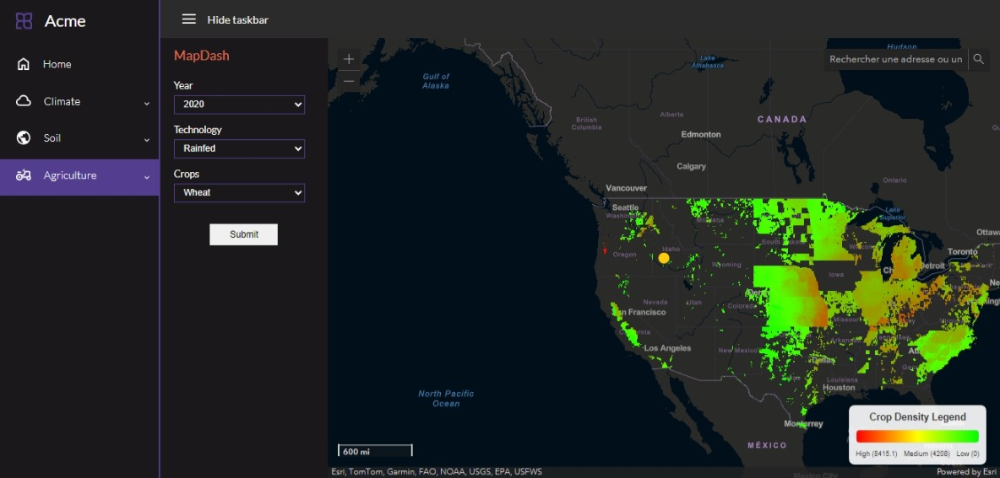
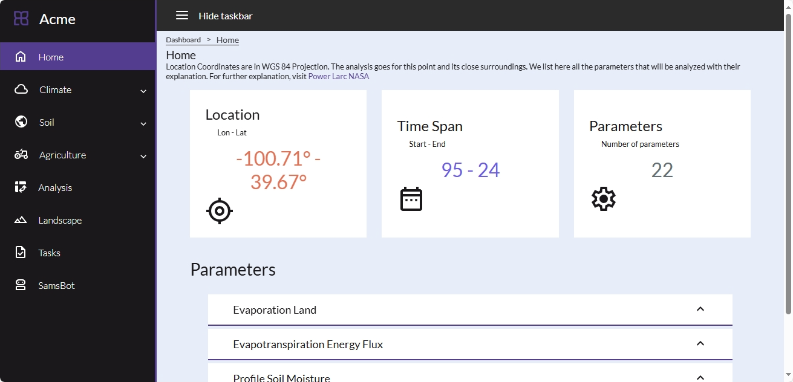
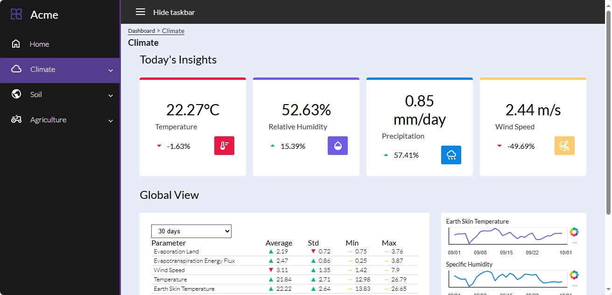
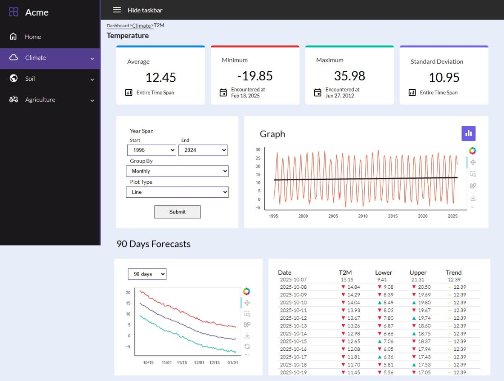
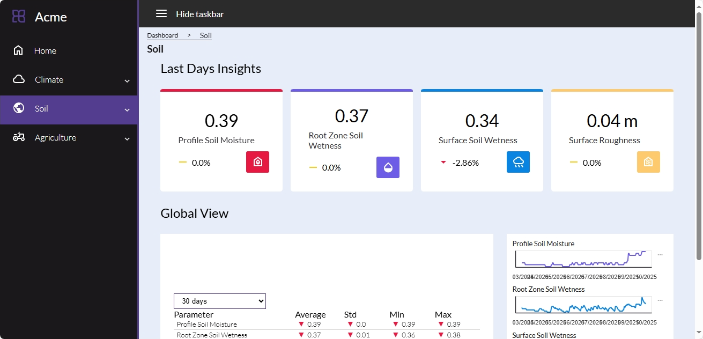
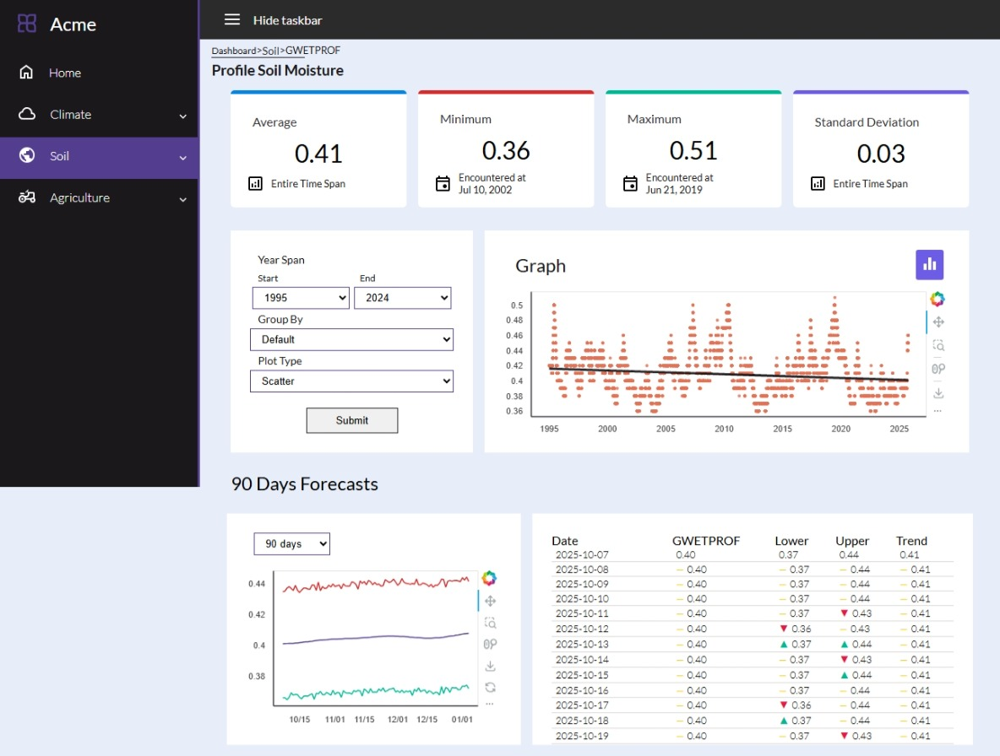
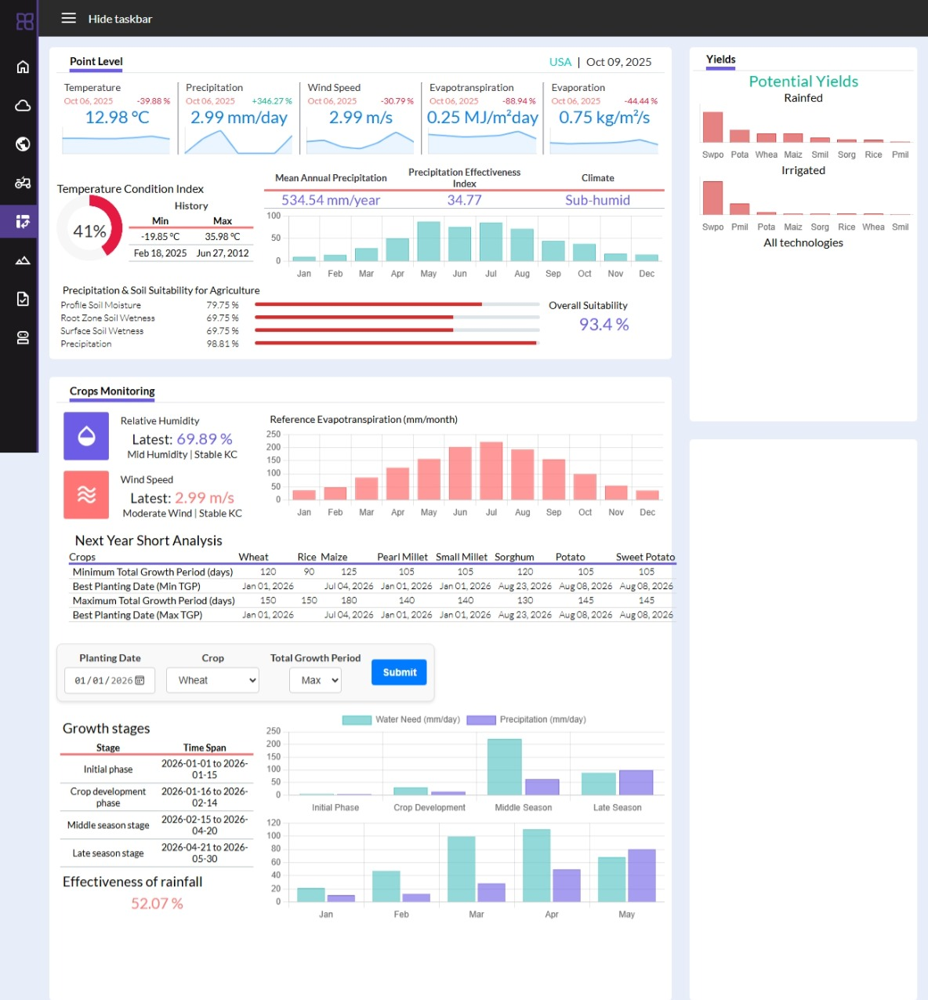
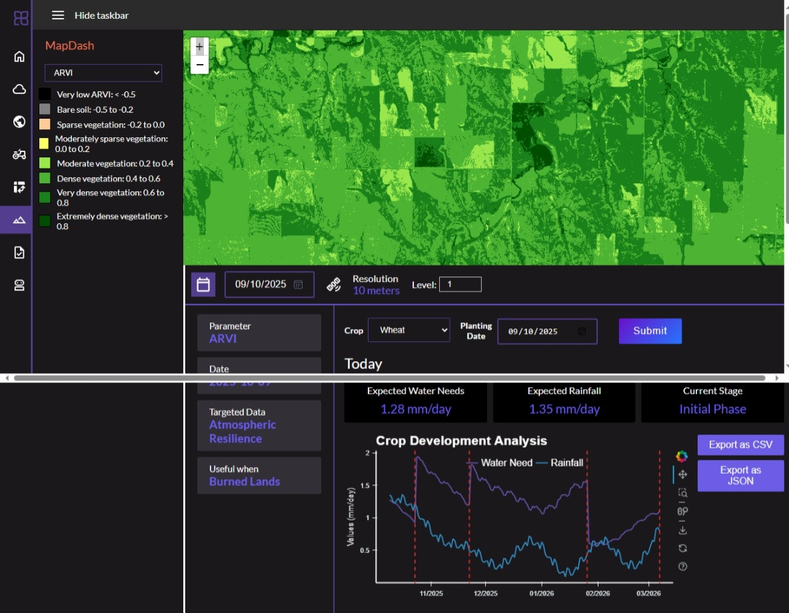
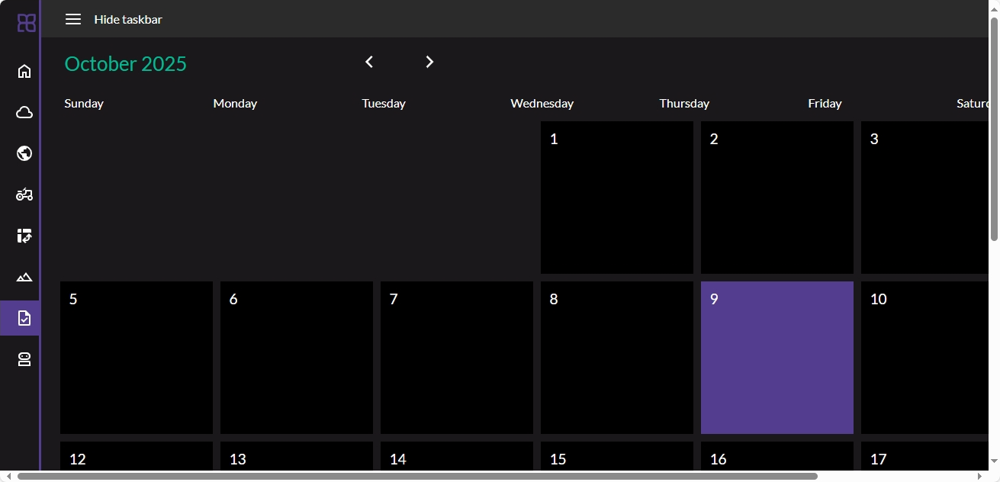
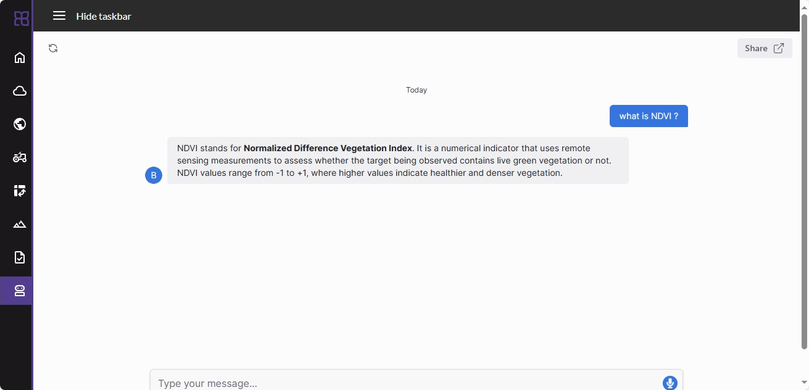

# SAMS
Smart Agriculture Monitoring System: Harvesting and Analysing World AgriData

SAMS is an open source agriculture dashboard. Its purpose is to describe the best possible impact of climatic conditions and soil characteristics on the yield of a total of 42 crops. It carries with it all analysis and forecasts for each variable selected. The main objective of this project is to give insights on climate data and agricultural data.

This project was powered by [Power Larc NASA](https://power.larc.nasa.gov/) (for climatic and soil data) and [MapSpam](https://mapspam.info/) for Agriculture Data

## Functionalities

### Home page or first page

The home page provides an overview of the main indicators and the general time span used throughout the application. However, in certain sections of the application, we go beyond these core indicators and explore additional variables available through the [Power Larc NASA](https://power.larc.nasa.gov/) project. The application itself uses data from 1995 up to the most recent day available on [Power Larc NASA](https://power.larc.nasa.gov/)
, making it more real-time than what the home page summary reflects. For the analysis page, however, we restrict the time span to the one displayed on the home page.

Below is a visual of the home page:

As we can see, we have the chosen point coordinates, timespan, and the parameters

### Climate indicators analysis page

The climate analysis page show a brief overview over the variations, tendances over the evolution of the climate indicators described on the home page. These include basic statistics and graphics just showing evolution in these.

Here is a visual of the climate page

And for each specific indicator, we show specific analysis on these. Here is an example for temperature variable.

### Soil indicators analysis page

The soil analysis page is basicalled the climate analysis page but for soil indicators.

Below are visuals of the soil analysis page and specifically for profile soil moisture example

### Agriculture analysis page

This page is designed to show farmers how crop productions, yields, harvested areas and production areas are distributed at country-level for a total of 42 crops discussed on the [MapSpam](https://mapspam.info/) project.

Visuals of the yields map for wheat below

### Analysis page

On the analysis page, we present detailled analysis of indicators we mentioned in the home page. Pay attention to the fact that this page is not complete and is not quite functional yet. It still needs improvements both on design and content.

### Landscape page

Next is the landscape page which gives an interactive map of the land located at the point the user selected, there is possibility to change the parameters and understand what is going on on the land. Although this is also not complete,further work on it would consist probably on implementing methods to retrieve these data in real-time, analyse them and give meaningful insights to the farmer about his land.

### Tasks and SamsBot page

These pages are designed to help the farmer schedule work on his land and discuss with a chatbot that will help him understand things about his land in real-time and such things. These pages are also not complete and further implementation would consist on adding reminders, mail notifications, etc..., train a very specific LLM designed specifically for this task.

### Overall

This is a bad work with (we believe) good ideas. There are plenty of fallbacks in all that is here, it is not intuitive, it is not good looking and it was rushed but there are still good things to point out of it, the idea is not good, the models are not bad but they really need improvements. Briefly, a lot of work to do for 70% bad and 30% good result here.

## Development

This project was developed using Flask mainly as Web Development framework. The dashboard uses Python 3.11.9 as Language for processes (core) and HTML, JS and CSS for pages (front).

### Run the app locally

In case, you are interested in running the code locally, you are welcome to do it. Once you've downloaded the zip file for this repo, unzip it on your local machine. Then open the unzipped file, create a virtual environment and install packages that are in the file requirements.txt
To run the app, you still need to connect to the MongoDB cluster created for this purpose

You can now run your local url by entering the following cmd command: python app.py
This will launch a local url and your application with it

### Data Files

This application requires some data to work correctly. The climatic data is extracted directly through NASA Servers. Agricultural data on the other hand is stored on an AWS S3 Public Bucket. We just make HTTP Requests on AWS to get those data. Be aware that using this method could be slow since you will have to wait for the data to be downloaded by the app on AWS S3 before rendering anything else.

If you want the app to be fast, contact us to get the data locally.

## Build the project

The application is built upon Python 3.11.9. A version of Python equal or greater to this one is required for the project built. Note that you should probably make sure that Python is existing on your computer and that its version is >= 3.11.9.
Open a terminal with your machine and type <python --version>

- First downlaod the zip file of the repository and unzip it locally
- Navigate to the project folder: Open a terminal and navigate to the folder where the repository is unzipped.
- Create a Virtual Environment: type <python -m venv env>: This will create a virtual environment in a folder named env.
- Activate the Virtual Environment: 
On Windows: <.\env\Scripts\activate>
On macOS/Linux: "source env/bin/activate"

- Install Packages from requirements.txt: <pip install -r requirements.txt>
- Launch the application: <python app.py>

